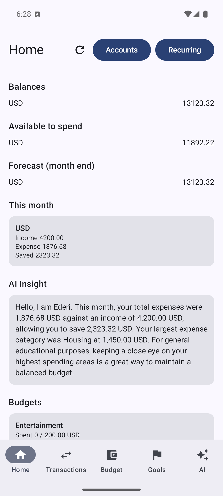
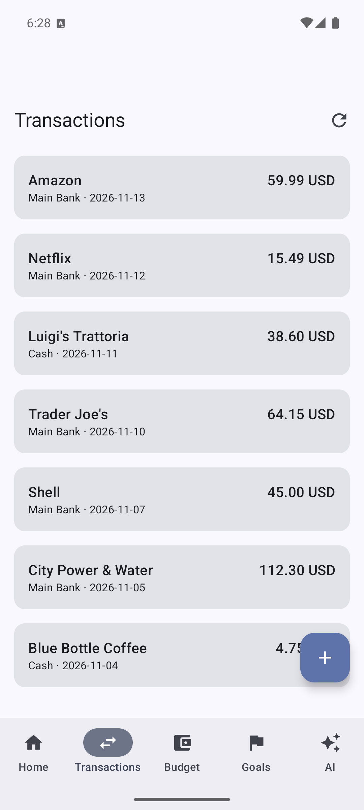
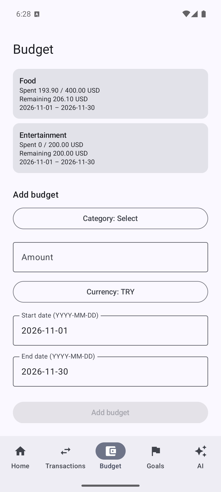
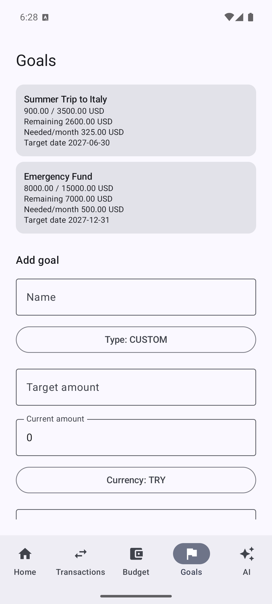
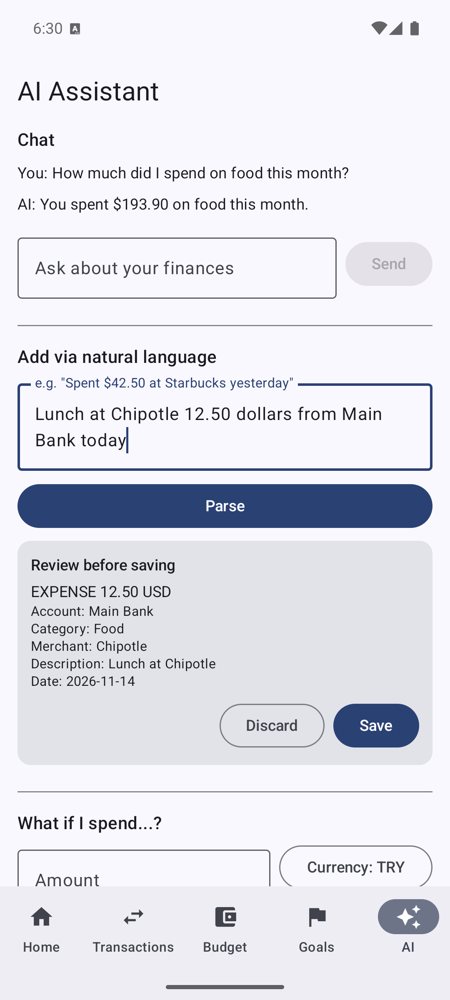
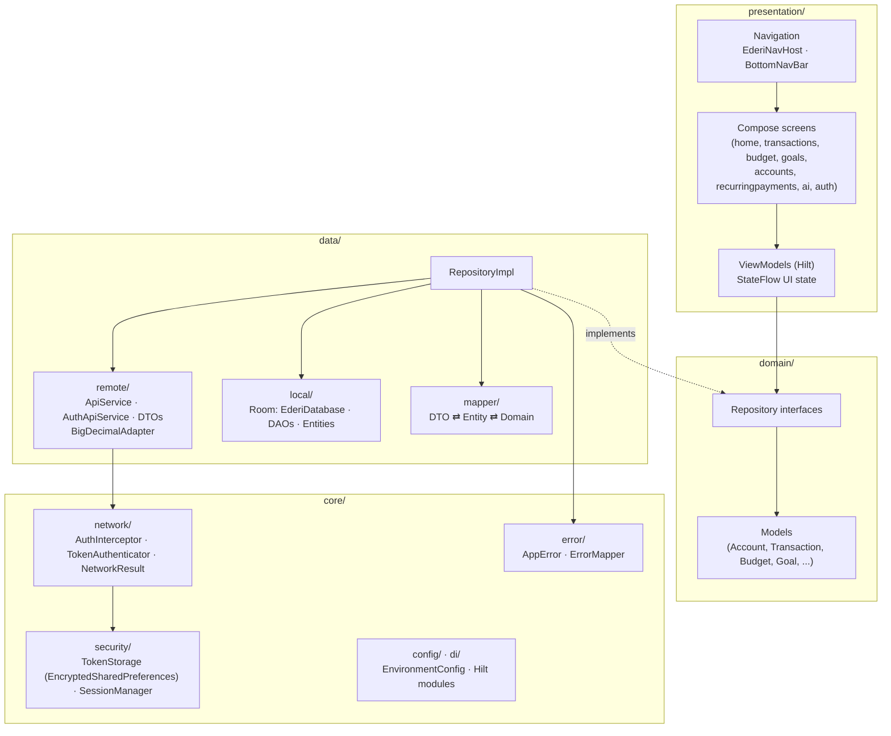

# Ederi — Android

Native Android client for **Ederi**, a personal finance app: accounts, transactions, budgets, goals, recurring payments, a dashboard, and an AI assistant (natural-language transaction entry, insights, chat, what-if scenarios).

The app is a thin client. All financial calculations and AI processing happen in the backend:
**Backend:** [github.com/mustafapolattr/ederi-backend](https://github.com/mustafapolattr/ederi-backend)

---

## Screenshots

> Screenshots will be added to `docs/screenshots/`.

| Home | Transactions | Budget | Goals | AI Assistant |
|------|--------------|--------|-------|--------------|
|  |  |  |  |  |

---

## Architecture

Single `:app` module, split into packages under `com.mustafa.ederi`:



---

## Key design decisions

- **The client never does financial math.** Balances, budget usage, forecasts, available-to-spend and scenario projections are computed by the backend; the app only displays what it receives, so there is a single source of truth for every number.
- **Money is `BigDecimal`, sent as a JSON string — never `Double`.** `BigDecimalAdapter` (Moshi) reads/writes decimal strings, matching DRF's `DecimalField` output; Room stores amounts as `TEXT`. Going through `Double` would silently lose precision.
- **Two separate Retrofit clients.** `@AuthClient` (login, register, refresh, logout) has no auth interceptor or authenticator; `@AuthenticatedClient` (everything else) has both. The refresh call therefore can never trigger another refresh, which rules out a 401 → refresh → 401 loop.
- **Token refresh is rotation-safe and deduplicated.** The backend rotates and blacklists refresh tokens on every use, so `TokenAuthenticator` always saves *both* the new access and refresh token. It is `synchronized` and compares the failed token with the stored one: concurrent 401s reuse the token the first caller just obtained instead of burning another rotation. A failed refresh clears tokens and signals logout via `SessionManager`.
- **Local-first repositories.** Accounts, categories and transactions are exposed as Room `Flow`s; `refresh*()` fetches from the API and upserts into the cache. Screens render cached data immediately and still show it when offline.
- **AI-suggested transactions are never saved without user confirmation.** `POST ai/parse-transaction/` only produces a preview; `AiViewModel.saveParsedTransaction()` runs only on an explicit Save tap, and only if the backend marked the suggestion valid with a resolved account and currency.
- **Cleartext only in dev, only for `10.0.2.2`.** The base `network_security_config.xml` forbids cleartext for every flavor; the `dev` flavor overrides it to allow HTTP to the emulator's host alias only. Staging and prod are HTTPS-only.

---

## Tech stack

| Area | Library |
|------|---------|
| Language / UI | Kotlin 2.2, Jetpack Compose (Material 3), Navigation Compose |
| DI | Hilt (+ hilt-navigation-compose) |
| Networking | Retrofit 2.12, OkHttp 4.12 (+ logging interceptor), Moshi 1.15 (KSP codegen) |
| Local storage | Room 2.8 (exported schemas in `app/schemas/`, explicit migrations) |
| Security | AndroidX Security Crypto — `EncryptedSharedPreferences` for tokens |
| Async | Kotlin Coroutines, `StateFlow` / `Flow` |
| Build | AGP 9.1, KSP, Gradle version catalog, JDK 21 toolchain |
| Testing | JUnit 4, MockK, Turbine, Truth, kotlinx-coroutines-test, OkHttp MockWebServer, Compose UI test, Hilt testing |

`minSdk 24`, `targetSdk 36`.

---

## Build & run

### Flavors

| Flavor | Application ID | Default `API_BASE_URL` | Cleartext |
|--------|----------------|------------------------|-----------|
| `dev` | `com.mustafa.ederi.dev` | `http://10.0.2.2:8000/api/v1/` | `10.0.2.2` only |
| `staging` | `com.mustafa.ederi.staging` | `https://staging.ederi.app/api/v1/` | No |
| `prod` | `com.mustafa.ederi` | `https://api.ederi.app/api/v1/` | No |

> **Note:** `staging.ederi.app` and `api.ederi.app` are **placeholders**, not live servers. Set `STAGING_API_BASE_URL` / `PROD_API_BASE_URL` (see below) to point these flavors at a real deployment.

```bash
./gradlew assembleDevDebug        # build
./gradlew installDevDebug         # install on a running emulator/device
./gradlew assembleProdRelease
```

### Overriding `API_BASE_URL`

`API_BASE_URL` is a `BuildConfig` field, read through `EnvironmentConfig`. Each flavor takes its value from, in order: `local.properties` → environment variable → default above.

```properties
# local.properties
DEV_API_BASE_URL=http://10.0.2.2:8000/api/v1/
STAGING_API_BASE_URL=https://staging.example.com/api/v1/
PROD_API_BASE_URL=https://api.example.com/api/v1/
```

The URL must end with `/api/v1/` (trailing slash required by Retrofit).

### Connecting to a local backend from the emulator

1. Run [ederi-backend](https://github.com/mustafapolattr/ederi-backend) on your machine on port `8000`, bound so the emulator can reach it (e.g. `0.0.0.0:8000`).
2. Build the `dev` flavor. `10.0.2.2` is the Android emulator's alias for the host's `localhost`, and it is the only host allowed over plain HTTP.
3. On a physical device, `10.0.2.2` doesn't work — set `DEV_API_BASE_URL` to an HTTPS URL the device can reach (cleartext to other hosts is blocked).

---

## Tests

```bash
./gradlew testDevDebugUnitTest            # JVM unit tests
./gradlew connectedDevDebugAndroidTest    # instrumented tests (needs emulator/device)
```

**Latest result** (`./gradlew testDevDebugUnitTest --rerun`): **37 tests in 11 classes, all passed** (0 failures, 0 errors, 0 skipped).

**Unit tests (`app/src/test`)**

| Area | What's covered |
|------|----------------|
| `TokenAuthenticator` | 401 → refresh → retry with new token; failed refresh forces logout (MockWebServer) |
| `ErrorMapper` | Success, 401, validation error envelope, AI quota (429) / rate-limit (503) messages, unparseable 500, timeout, no connection, 204 |
| `BigDecimalAdapter` | Decimal strings parsed/serialized without precision loss |
| Mappers | Account / Category / Transaction DTO ⇄ Entity ⇄ Domain round trips preserve amounts exactly |
| Repositories | `AccountRepositoryImpl` cache read + refresh upsert; `AiRepositoryImpl` parse, clarification, analyze, chat, scenario mapping |
| `AuthViewModel` | Login success/failure, register chaining into login |
| `EnvironmentConfig`, `NetworkResult` | Base URL is configured and versioned; result wrapper behavior |

**Instrumented tests (`app/src/androidTest`)**

- `EderiNavHostTest` — bottom navigation reaches each destination (Hilt test runner).

---

## Known limitations

- Only accounts, categories and transactions are cached in Room. Dashboard, budgets, goals, recurring payments and AI responses need a network connection.
- No offline writes — creating or deleting anything requires a connection.
- The transaction list fetches only the first page from the API; there's no pagination in the UI yet.
- The repositories support editing/deleting accounts and transactions, but the UI has no screens for this yet. Same for category management and logout.
- Budgets and goals can only be created and listed (the API client has no update/delete for them).
- AI chat history lives in memory only and is lost when the ViewModel is cleared.
- Bank integrations, CSV import and notifications are out of scope for the current phase.
- Release builds have `isMinifyEnabled = false`.
